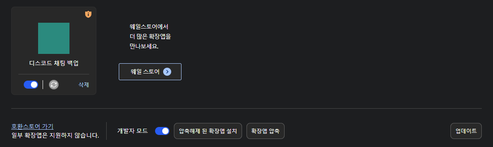
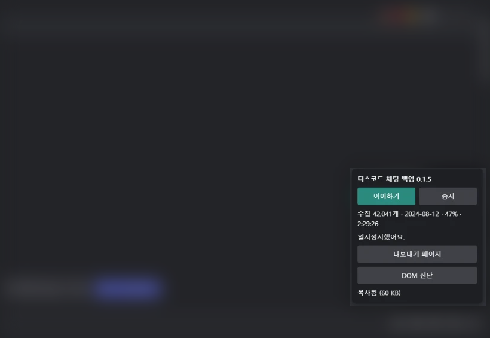
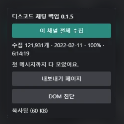
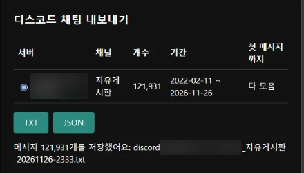
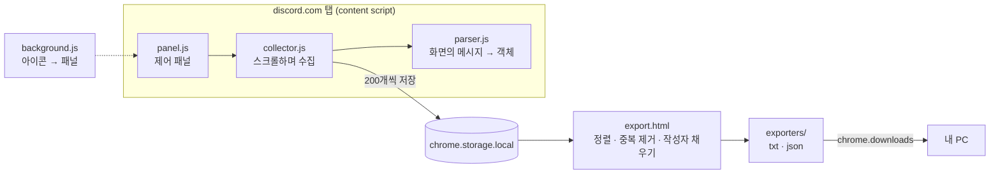

# 디스코드 채팅 백업

내 계정으로 볼 수 있는 디스코드 채널의 대화를 **첫 메시지부터 전부** 모아 내 PC에 TXT·JSON 파일로 저장하는 브라우저 확장 프로그램입니다. 디스코드 토큰이나 내부 API를 쓰지 않고, **화면에 그려진 것만 읽어서** 모읍니다.

> 메시지가 **121,931개** 쌓인 실제 채널(2022-02-11 ~ 2026-11-26)을 첫 메시지까지 빠짐없이 모았습니다.
> 네이버 웨일에서 일시정지 시간을 포함해 6시간 14분이 걸렸고, 읽지 못한 메시지는 0개였습니다.

## 사용 방법

### 1. 확장 프로그램 설치

빌드 과정이 없어서 이 폴더를 그대로 불러오면 됩니다. 네이버 웨일에서 시험했고, 크롬에서도 쓸 수 있게 만들었습니다.

1. 웨일은 `whale://extensions`, 크롬은 `chrome://extensions`를 엽니다.
2. **개발자 모드**를 켜고 **압축해제 된 확장앱 설치**(크롬은 **압축해제된 확장 프로그램을 로드합니다**)를 눌러 이 폴더를 고릅니다.



### 2. 디스코드를 새로고침하고 수집 시작

1. 열려 있던 discord.com 탭을 새로고침(F5)합니다. 설치 전에 열린 탭에는 확장 프로그램이 들어가지 않기 때문입니다.
2. 모을 채널이나 DM을 열고 툴바의 확장 아이콘을 누르면, 화면 오른쪽 아래에 패널이 열립니다.
3. **이 채널 전체 수집**을 누릅니다.

### 3. 기다리면 대화가 모입니다

패널에 모은 개수, 지금 읽고 있는 날짜, 진행률, 걸린 시간이 나옵니다. 언제든 일시정지하거나 중지할 수 있고, 중지해도 그때까지 모은 메시지는 남습니다.



첫 메시지까지 닿으면 "첫 메시지까지 다 모았어요."라고 알려 줍니다.



### 4. 내보내기

패널의 **내보내기 페이지**를 누르면 모은 채널 목록이 나옵니다. 채널을 고르고 **TXT**나 **JSON**을 누르면 다운로드 폴더에 저장됩니다.



TXT는 사람이 읽기 좋게, JSON은 다른 프로그램에서 쓰기 좋게 저장합니다. 아래는 가짜 데이터로 만든 TXT 예시입니다.

```text
──── 2025-01-01 ────
[2025-01-01 21:04] 철수: 내일 모임 몇 시였지?
[2025-01-01 21:05] 영희: 7시! 장소는 여기
    [링크] 모임 장소 https://example.com/map
[2025-01-01 21:06] 철수: 고마워 (수정됨)
    ↳ 답장: 영희 「7시! 장소는 여기」
[2025-01-01 21:10] 영희: 사진 올려 둘게
    [첨부] photo.png https://cdn.discordapp.com/attachments/…
[2025-01-01 21:12] * 철수 님이 이 채널에 메시지를 고정했어요.
```

## 기능

- 채널이나 DM 하나를 첫 메시지까지 수집합니다.
- 본문, 작성자, 시각, 답장, 수정 여부, 첨부 링크, 링크 미리보기, 스티커, 반응, 시스템 메시지를 저장합니다.
- TXT·JSON으로 내보냅니다. 파일 이름은 `discord_<서버>_<채널>_<날짜-시각>`입니다.
- 일시정지·이어하기·중지를 할 수 있고, 창이 가려지면 저절로 일시정지합니다.
- **DOM 진단**은 디스코드 화면 구조를 대화 내용 없이 리포트로 뽑아, 셀렉터를 실제 화면으로 확인하게 해 줍니다.

앞으로 만들 것: 여러 채널 대기열과 새로고침 뒤 이어하기(Phase 2), CSV·HTML·ZIP(Phase 3), 첨부파일 내려받기(Phase 4), 날짜 범위 지정(Phase 5).

## 구조



- **제어 패널을 디스코드 페이지 위에 둡니다.** 팝업이나 다른 탭에서 조종하면 디스코드 탭이 가려지고, 가려진 탭은 렌더링과 타이머가 멈춰서 수집도 멈춥니다.
- **파일은 확장 페이지(export.html)에서 만듭니다.** Manifest V3의 서비스 워커는 30초 쉬면 꺼지고 Blob URL도 만들 수 없습니다.
- 수집한 메시지는 200개씩 `chrome.storage.local`에 저장해서, 중간에 멈추거나 탭을 닫아도 남습니다.

```
content/    selectors.js parser.js store.js collector.js diagnose.js panel.js
export/     export.html export.css export.js
exporters/  txt.js json.js
shared/     snowflake.js filename.js authors.js
tests/      *.test.mjs (node:test)
```

## 풀어낸 문제

### 가상 스크롤
디스코드는 화면 근처의 메시지만 그리고 나머지는 지웁니다. 스크롤할 때마다 보이는 메시지를 읽고 ID로 중복을 없앱니다. 디스코드가 메시지를 지우는 순간에도 `MutationObserver`로 한 번 더 읽어서 빠뜨리지 않습니다.

### 143개에서 멈추는 문제
처음에는 맨 위(`scrollTop = 0`)로 바로 올렸는데, 디스코드가 아래쪽 글을 지울 때 기준을 잃고 회색 자리표시 안에 갇혀 더 불러오지 않았습니다. 첫 메시지가 화면에 보이는 위치로 올리는 방법을 포함해 다섯 가지 스크롤 방법을 차례로 시도하고, 통한 방법을 기억하게 바꿨습니다.

### 스크롤에 반응하지 않게 되는 문제
한참 불러오다 보면 디스코드가 스크롤 위치가 바뀌어도 더 불러오지 않고, 사람이 굴린 휠에만 반응했습니다. 가짜 휠 신호를 넣는 방법은 계정 위험 때문에 쓰지 않았습니다. 대신 가장 옛 메시지 **바로 앞**의 메시지 링크로 같은 탭에서 이동해, 디스코드가 그 자리부터 새로 불러오게 했습니다.

처음에는 가장 옛 메시지 자체로 이동했는데, 이미 화면에 있는 메시지라서 디스코드가 그리로 스크롤만 하고 끝났습니다. ID를 1 줄여 화면에 없는 자리로 옮기자 새로 불러오면서 풀렸습니다. 이렇게 원인을 좁히려고 진단 리포트에 스크롤 기록과 막힌 시점을 남겼고, 실제 디스코드에서 본 현상을 가짜 디스코드 페이지에 그대로 재현한 다음 고쳤습니다.

### 연속 메시지의 작성자
같은 사람이 이어서 쓴 메시지에는 화면에 이름이 없습니다. 내보낼 때 ID 순으로 정렬한 뒤, 이름이 없는 메시지는 직전 메시지의 작성자로 채웁니다.

### 가려진 탭
탭이 가려지면 브라우저가 렌더링과 타이머를 멈춥니다. `visibilitychange`로 알아채 자동으로 일시정지하고, 다시 보이면 이어서 합니다.

### 64비트 ID
디스코드 ID(스노플레이크)는 64비트라 `Number`로 바꾸면 값이 깨집니다. 문자열로 두고 비교와 정렬은 `BigInt`로 합니다. ID에는 만든 시각이 들어 있어서, 채널 ID로 채널이 생긴 날을 알아내 진행률을 계산합니다.

### 실제 대화 없이 디버깅하기
디스코드 화면 구조를 확인하려면 실제 화면이 필요하지만, 대화 내용을 주고받을 수는 없습니다. DOM 진단 리포트는 허용한 단어 말고는 모든 글자를 「n자」로, 긴 숫자 ID를 `{id}`로 바꿔서 화면 구조만 담습니다.

## 시험

- 파일 이름, ID 계산, 작성자 채우기, TXT·JSON 형식 같은 순수 함수는 `node --test`로 시험합니다.
- 확장 전체는 헤드리스 웨일과 가짜 디스코드 페이지로 시나리오 40여 개를 시험했습니다.
  - 디스코드가 옛 글을 언제 불러오는지 알 수 없어서, 가능한 규칙 12가지를 가짜 디스코드에 넣고 모두 통과하게 했습니다.
  - 실제 디스코드에서 본 막힘(불러오기 차단, 스크롤이 안 먹는 상태)도 그대로 재현해 넣었습니다. 고치기 전 버전이 이 시험에서 실패하는 것도 확인했습니다.
  - 창 가림, 일시정지, 채널 이동, 확장 다시 로드 같은 경우도 시험했습니다.
  - 이 시험 도구는 로컬에서만 쓰고 저장소에는 넣지 않았습니다.
- 위의 12만 개 채널을 내보낸 결과, 읽지 못한 메시지와 작성자를 모르는 메시지가 모두 0개였습니다.

## 토큰과 API를 쓰지 않은 이유

디스코드 이용약관은 사용자 계정을 자동화하는 것과 공개되지 않은 API를 쓰는 것을 금지하고, 어기면 계정이 정지될 수 있습니다. 그래서 위험을 줄이려고 이렇게 만들었습니다.

- 토큰, 내부 API(`/api/v9/...`), 게이트웨이 WebSocket을 쓰지 않습니다.
- 화면에 그려진 DOM만 읽습니다. 하는 조작은 메시지 목록 스크롤과 같은 탭 안의 주소 이동뿐이고, 메시지 입력·반응·삭제 같은 버튼은 누르지 않습니다.
- 사람이 빠르게 스크롤하는 수준을 넘지 않게 간격을 두고 쉬어 갑니다.

이렇게 해도 약관 위반이 아니라고 보장하지는 않습니다. 사용에 따른 책임은 사용자에게 있습니다.

## 한계

- 디스코드 창이 화면에 보여야 수집됩니다. 최소화하거나 다른 창으로 완전히 덮으면 멈춥니다.
- 속도가 사람이 스크롤하는 수준이라 큰 채널은 몇 시간이 걸립니다.
- 지금은 한 번에 채널 하나만 모읍니다.
- 첨부파일은 아직 링크만 저장합니다. 디스코드 첨부 링크는 약 24시간 뒤 만료됩니다.
- 디스코드 화면 구조가 바뀌면 `content/selectors.js`를 고쳐야 합니다.

## 고지

이 프로젝트는 디스코드(Discord Inc.)와 관계없는 개인 백업 도구입니다. 내 계정으로 볼 수 있는 대화만 내 PC에 저장합니다. 모은 대화를 다른 사람에게 보여 주거나 공개할 때는 대화에 참여한 사람들의 동의를 받아야 합니다. 이 문서의 이미지는 다른 사람의 이름과 대화를 가린 것입니다.

## 만든 방법

순수 JavaScript·HTML·CSS로 만든 Manifest V3 확장이고, 프레임워크와 빌드 과정이 없습니다. [Claude Code](https://claude.com/claude-code)와 함께 단계(Phase)별로 만들었으며, 작업 규칙은 [CLAUDE.md](CLAUDE.md)와 [PROMPTS.md](PROMPTS.md)에 있습니다.
